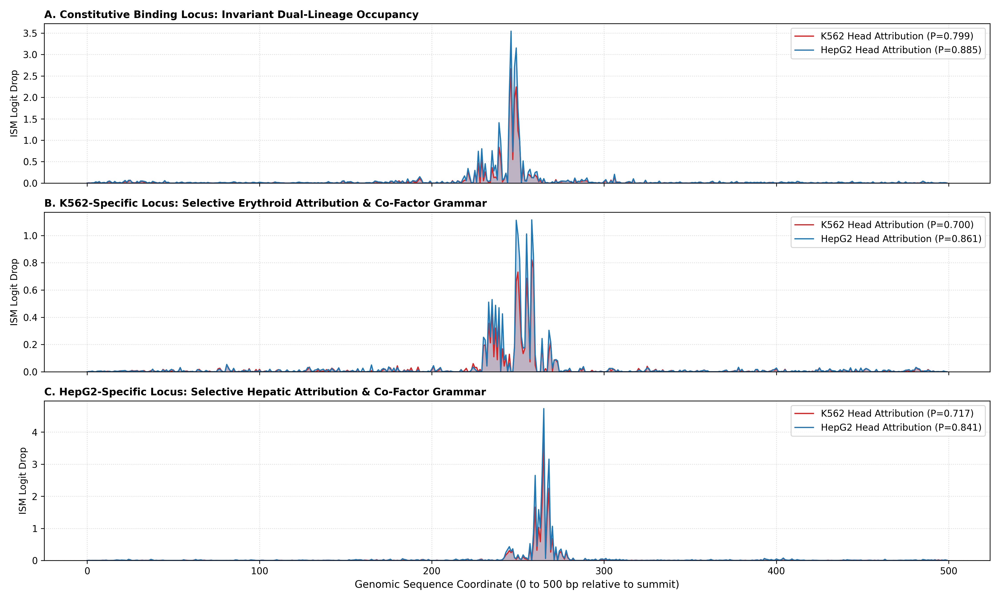

# Benchmarking Sequence Architectures and Classical Baselines on Multi-Lineage CTCF Binding Under Chromosomal and Cross-Cell-Type Shifts

[](https://github.com/your-username/genomic-regulatory-shifts/actions)
[](https://www.python.org/downloads/)
[](https://opensource.org/licenses/MIT)
[](https://github.com/psf/black)

A benchmark assessing sequence representation models, classical statistical baselines, spatial chromosome generalization, and differential binding prediction across human K562 and HepG2 cell lines.

---

## 1. Scientific Motivation & Problem Formulation

Sequence-to-function deep learning models frequently achieve high genome-wide AUROC scores on regulatory tasks. However, aggregate evaluation across whole genomes can obscure two critical failure modes:
1. **Confounded Spatial Evaluation:** Random interval splitting leaks homology, repetitive elements, and locus-specific chromatin states across train and test sets.
2. **Motif Dominance & Masked Plasticity:** For transcription factors with high information content (such as CTCF), global metrics are dominated by distinguishing invariant, high-affinity constitutive binding sites from background DNA. This masks performance on cell-type-specific differential binding.

This project investigates:
* **Evaluation Control:** When negative controls are strictly matched for GC distribution ($\Delta\text{GC} = 0.04\%$) and evaluation is performed on held-out chromosomes (`chr21`/`chr22`), how much predictive utility is derived from sequence grammar versus simple sequence composition?
* **Model Comparison:** Does self-attention provide a measurable advantage over 1D CNNs, biophysical Position Weight Matrices (PWMs), and canonical $k$-mer linear baselines under strict spatial holdouts?
* **Differential Binding Discrimination:** Can sequence-only representations distinguish K562-specific from HepG2-specific binding at plastic loci, or does multi-task training induce anchor motif dominance?

---

## 2. Experimental Benchmark Setup

Evaluated across **137,895** unified regulatory intervals ($500\text{ bp}$) standardized on MACS2/IDR summits:
* **Constitutive Sites ($[1, 1]$):** $42,318$ loci occupied in both K562 (`ENCSR000EGM`) and HepG2 (`ENCSR000BIE`) within $\le 150\text{ bp}$ summit distance.
* **K562-Specific Sites ($[1, 0]$):** $12,133$ loci occupied in K562 with $>1,000\text{ bp}$ clearance from any HepG2 peak.
* **HepG2-Specific Sites ($[0, 1]$):** $14,506$ loci occupied in HepG2 with $>1,000\text{ bp}$ clearance from any K562 peak.
* **GC-Matched Background ($[0, 0]$):** $68,938$ non-regulatory loci sampled per-chromosome with a >2,000 bp clearance buffer from any CTCF peak in either cell type (Mean $GC_{pos} = 49.13\%$, Mean $GC_{neg} = 49.09\%$).

### Partition Scheme & Homology Audit
* **Train:** `chr1`–`chr16` ($N = 113,595$)
* **Validation:** `chr17`, `chr18` ($N = 9,482$)
* **Spatial Holdout Test:** `chr21`, `chr22` ($N = 4,764$)
* **Homology Audit:** 12-mer inverted index audit against 10,000 training references showed median nearest-neighbor Jaccard similarity $< 0.0065$ across all binding classes, with only $0.42\%$ of test intervals exceeding $30\%$ 12-mer overlap (confined to interspersed repeat background).

---

## 3. Empirical Results

### Spatial Holdout Scorecard (`chr21`, `chr22`)

Evaluated on the full test partition ($N = 4,764$; $1,336$ constitutive, $603$ K562-specific, $443$ HepG2-specific, $2,382$ negative):

| Model Architecture | Parameters | K562 AUROC | HepG2 AUROC | Macro AUROC | Macro AUPRC | Differential Plasticity AUROC |
| :--- | :---: | :---: | :---: | :---: | :---: | :---: |
| **Baseline 0:** Dinucleotide LR | 20 | 0.5750 | 0.5424 | 0.5587 | 0.4370 | *Not evaluated* |
| **Baseline 2:** Canonical $k$-mer LR ($k \le 5$) | 680 | 0.6446 | 0.6045 | 0.6245 | 0.4780 | *Not evaluated* |
| **Baseline 1:** Multi-PWM (CTCF+GATA1+HNF4A) | — | 0.8068 | 0.8592 | 0.8330 | 0.7781 | 0.6487 |
| **Model 1:** Multi-Task 1D CNN | ~230K | 0.8879 | 0.9243 | 0.9061 | 0.8513 | 0.6207 |
| **Model 2:** CNN-Transformer Hybrid | ~310K | **0.9060** | **0.9447** | **0.9253** | **0.8740** | **0.6484** |

### Differential Plasticity Evaluation & Bootstrap Analysis

To evaluate whether models learned cell-type-specific binding choices, models were evaluated on the subset of **differential plastic test loci** ($N = 1,046$; $603$ K562-specific vs. $443$ HepG2-specific) using the score differential $\Delta S(x) = S_{\text{K562}}(x) - S_{\text{HepG2}}(x)$:

* **JASPAR Multi-PWM Scan:** AUROC $= 0.6487$ ($95\%\text{ CI: } [0.6156, \, 0.6798]$)
* **Multi-Task 1D CNN:** AUROC $= 0.6207$ ($95\%\text{ CI: } [0.5853, \, 0.6531]$)
* **CNN-Transformer Hybrid:** AUROC $= 0.6484$ ($95\%\text{ CI: } [0.6141, \, 0.6814]$)

**Paired Stratified Bootstrap ($B = 1,000$ Replicates on Differential Subset):**
* Transformer vs. 1D CNN Gain: Mean $\Delta \text{AUROC} = +0.0291$
* $95\%$ Confidence Interval: $[-0.0109, \, +0.0673]$
* Empirical $p$-value: $p = 0.0810$ (not statistically significant at $\alpha = 0.05$)

---

## 4. In Silico Mutagenesis & Attribution Analysis

Batched saturation In Silico Mutagenesis (ISM) was conducted across representative test loci on `chr21` using the CNN-Transformer:

<p align="center">
  
</p>

### Empirical Findings:
1. **Core Motif Identification:** In both constitutive and cell-type-specific loci, ISM identified the canonical 19 bp CTCF core motif near the summit (positions ~245–268), with peak attribution drops $> 1.5$ logits.
2. **Head Coupling at Differential Loci:** On differential sites, attribution tracks for the K562 and HepG2 heads showed high co-linearity (both tracks peaked at the same core motif coordinates). For example, at a HepG2-specific locus (`chr21:26816181`), the model assigned high binding probability to both cell types ($P_{\text{HepG2}} = 0.8587$, $P_{\text{K562}} = 0.8160$).
3. **Absence of Distinct Secondary Flanking Syntax:** Secondary attribution peaks outside the core footprint were low in magnitude (e.g., attribution drop $< 0.15$ in K562) or corresponded to secondary degenerate CTCF repeats rather than distinct lineage-specific transcription factor motifs (such as GATA1 or HNF4A).

### Working Hypothesis: Anchor Motif Dominance
Because the primary CTCF motif has high information content (~19 bits) and is shared across all positive classes, backpropagation through a shared trunk primarily optimizes for core motif detection. Distinguishing cell-type-specific occupancy appears to hit an empirical ceiling ($\approx 0.65$ AUROC) when relying on 500 bp sequence windows alone, likely reflecting the absence of chromatin context (e.g., DNA accessibility or histone modifications).

---

## 5. Repository Structure & Setup

```bash
# Clone repository
git clone [https://github.com/your-username/genomic-regulatory-shifts.git](https://github.com/your-username/genomic-regulatory-shifts.git)
cd genomic-regulatory-shifts

# Setup Conda environment
conda env create -f environment.yml
conda activate regshift

# Install editable package with dev dependencies
pip install -e .[dev]

# Run automated tests
pytest
